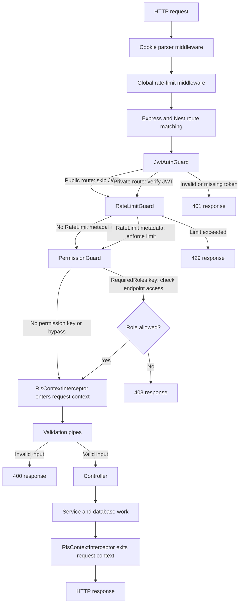
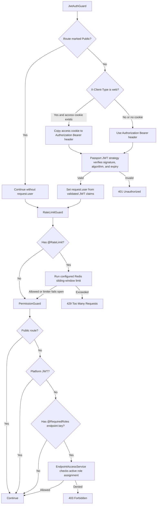
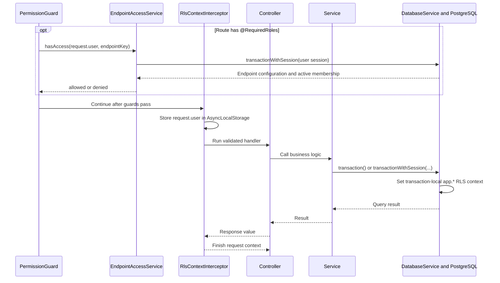

# API Request Flow

This document describes the request lifecycle shared by most Fortis backend
HTTP routes, how the global NestJS components interact, and where individual
routes add behavior. The application uses the `/api/v1` global prefix.

## Shared HTTP lifecycle

The global guard order is `JwtAuthGuard` → `RateLimitGuard` → `PermissionGuard`.
Public routes skip only JWT authentication and the dynamic permission check;
they still pass through the rate-limit guard. `RateLimitGuard` reads the route's
`@RateLimit` metadata and calls `RateLimitMiddleware` with those options. Routes
without that decorator are not route-rate-limited by this guard.

The global `RateLimitMiddleware` is also registered in `main.ts` before route
matching. The guard supplies the route configuration after Nest has identified
the handler, so route limits do not depend on the early middleware finding
handler metadata.

The RLS interceptor wraps parameter validation and controller execution. It
places `request.user` in `AsyncLocalStorage`; public requests without a user run
with an empty context. Database transactions should use
`DatabaseService.transaction()` to use that request context or
`transactionWithSession(session, ...)` when the service already has an explicit
session. The database service sets transaction-local PostgreSQL configuration
values used by RLS policies.

## Authentication and permission decisions

The JWT strategy validates the token before exposing its claims as
`request.user`. The permission guard skips public routes and platform users. If
a private route has no `@RequiredRoles` metadata, the guard allows it after
authentication. If it has an endpoint key, `EndpointAccessService` checks the
business's endpoint-role configuration against the user's active membership.

`@RequiredRoles()` identifies an endpoint key; it does not contain role IDs.
`@Public()` takes precedence in the permission guard. As a result, the
`users.login` metadata on user login and `users.refresh` metadata on user
refresh do not trigger permission checks because those routes are public.

## RLS and database work

Dynamic role checks happen in a guard, before interceptors run. The endpoint
access service therefore passes the authenticated session explicitly to
`transactionWithSession()`. In handlers and services, the RLS interceptor's
request context is available through `transaction()`; explicit session
transactions are also supported.

## Input validation and response

The global `ValidationPipe` is configured with `whitelist: true` and
`transform: true`. DTOs used for body, query, and path parameters are validated
before the controller handler runs. Individual parameters can add more specific
pipes. For example, `/authentication/me` maps `x-client-type` and
`x-terminal-id` into a DTO and validates the enum and UUID with a parameter
pipe.

When the handler succeeds, its return value becomes the response body. A
controller can also set cookies through the Express response. User and platform
login/refresh return tokens in JSON for mobile/desktop clients; web behavior
sets HTTP-only cookies and omits tokens from the JSON body.

Errors short-circuit the normal response path. Common statuses are 400 for
validation or invalid input, 401 for authentication failures, 403 for dynamic
role denial, and 429 for an exceeded route limit. Service exceptions are
handled by Nest's HTTP exception handling.

## Current route map

| Route                                                  | Public? | Rate limit         | Permission / extra validation                                                                                                 |
| ------------------------------------------------------ | ------- | ------------------ | ----------------------------------------------------------------------------------------------------------------------------- |
| `GET /api/v1/`                                         | Yes     | None               | Returns the greeting.                                                                                                         |
| `POST /api/v1/onboarding`                              | No      | None               | Controller checks that the body is a JSON object.                                                                             |
| `GET /api/v1/authentication/me`                        | No      | 60 per minute      | No `@RequiredRoles`; validates client type and terminal UUID, then checks user, active context, role, and terminal under RLS. |
| `POST /api/v1/authentication/login`                    | Yes     | 100 per hour       | Validates login DTO; `users.login` metadata is skipped because route is public.                                               |
| `POST /api/v1/authentication/refresh`                  | Yes     | **None currently** | `users.refresh` metadata is skipped because route is public.                                                                  |
| `POST /api/v1/platform/user/login`                     | Yes     | 20 per minute      | Validates platform login DTO.                                                                                                 |
| `POST /api/v1/platform/user/refresh`                   | Yes     | 60 per minute      | Validates refresh token and client type in controller.                                                                        |
| `GET /api/v1/business/endpoint-access/endpoints`       | Yes     | None               | Lists configurable endpoint catalog.                                                                                          |
| `GET /api/v1/business/endpoint-access`                 | No      | None               | Service verifies business owner before listing configuration.                                                                 |
| `PUT /api/v1/business/endpoint-access/:endpointKey`    | No      | None               | Validates path/body; service verifies owner and role IDs.                                                                     |
| `DELETE /api/v1/business/endpoint-access/:endpointKey` | No      | None               | Validates path; service verifies owner before deletion.                                                                       |

## Adding a route

1. Leave the route private by default. Add `@Public()` only when authentication
   should be skipped.
2. Add `@RateLimit({ requests, windowMs })` when the route needs a limit. The
   global `RateLimitGuard` enforces it.
3. Add a DTO and validators for input. Use parameter pipes when a specific path
   or header format needs validation.
4. Add `@RequiredRoles('endpoint.key')` only when access should be controlled by
   the business's endpoint-role configuration. Do not add it to public routes;
   public routes bypass that check.
5. Use RLS-scoped transactions for database access. Prefer `transaction()` in
   request services and `transactionWithSession()` when passing an explicit
   authenticated session.
